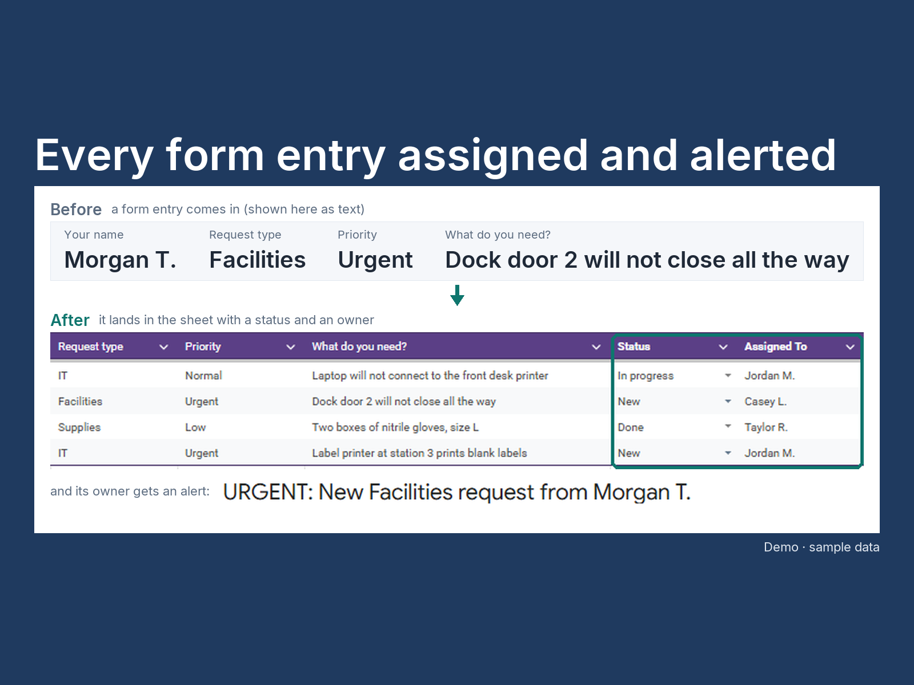

# Google Form to Sheet to automatic alerts

A Google Apps Script attached to a form's response sheet: each new entry gets a status and an owner, the owner gets an email, and a daily summary lists what is still open.



## What it does

- **On each new response:** sets Status to `New`, fills in who it is assigned to from a Routing tab, and emails that person an alert (urgent requests say so in the subject).
- **On each Status change:** records it in a Run Log tab, with before and after.
- **Once a day:** emails a summary of everything still open, grouped by assignee, urgent first, oldest first.
- **Always:** writes every run and every error to the Run Log, so "did it send?" has an answer. Nothing is skipped silently.

## Demo

**All data in this repository is invented.** The 15 form responses in `sample-data/responses.csv` and the names in them are made up, and no email address appears in any file.

**Offline, in under a minute** (Node 20 or newer; nothing to install, no Google account):

```powershell
node --test
```

The tests load the two `.gs` files into Node with stand-ins for Google's services (a fake spreadsheet, fake mail, fake triggers) and play the whole flow: responses arriving, routing, the alert emails, status edits, the daily summary and the Run Log. One test replays the walkthrough in `DEPLOY.md` step by step.

**Live in Google, about 15 minutes:** follow [`DEPLOY.md`](DEPLOY.md). Create the form, link it to a sheet, paste `src/Code.gs` and `src/Logic.gs` into Extensions > Apps Script, run `setup()` once and approve Google's permission prompt. Demo mode is on: every email goes to the account that owns the script, whoever the request is assigned to, so no made-up person is ever emailed.

## How it's built

- **Two files with a clean split.** `Logic.gs` holds the decisions (who gets what, what the emails and log lines say) and makes no Google calls, so it is testable anywhere. `Code.gs` holds the settings, `setup()` and the three triggers, and is the only file that touches the sheet and the mail service.
- **Routing lives in the sheet, not the code.** Who handles which request type is a Routing tab; changing it needs no code change.
- **Every run is logged.** The Run Log tab records each trigger run, each status change and each error, newest first, trimmed to the last 500 rows.
- **No credentials anywhere.** The script runs inside the owner's Google account under `@OnlyCurrentDoc`, limited to the one spreadsheet it is attached to. Google asks for permission once in the browser; nothing is copied or stored. The owner's address is read from Google at run time and never written down.
- **Safe at the edges:** a trigger that fires twice sends nothing twice; a request type with no routing rule goes to the owner with a note; mail failures land in the Run Log and are passed on so Google reports them too.

What to change and where, the behaviour at the edges, the limits, the permissions and the dependency licences are in [`docs/DETAILS.md`](docs/DETAILS.md).

## Tests

```powershell
node --test
```

Node's built-in test runner; no npm packages and no `package.json`. The tests cover the routing and email text (`logic.test.js`), the sheet, mail and trigger calls against stand-ins (`handlers.test.js`), and the repository itself: no email address in the script, the manifest or the sample data, and every sample request type has a routing rule (`repo.test.js`). Current run (2026-11-04): **46 tests, 46 passed.** The script also ran live in Google on 2026-10-02 following `DEPLOY.md`, with every Run Log row OK.

## Built by AZG Engineering

Built by [AZG Engineering](https://azgengineering.com), small automations for small businesses and public-sector teams.

## Licence

Copyright © 2026 Azimuth Group LLC. All rights reserved. Published as a work sample; no licence to reuse it is granted. The Inter font in `tools\fonts\` is under the SIL Open Font License 1.1 (`tools\fonts\OFL.txt`).
